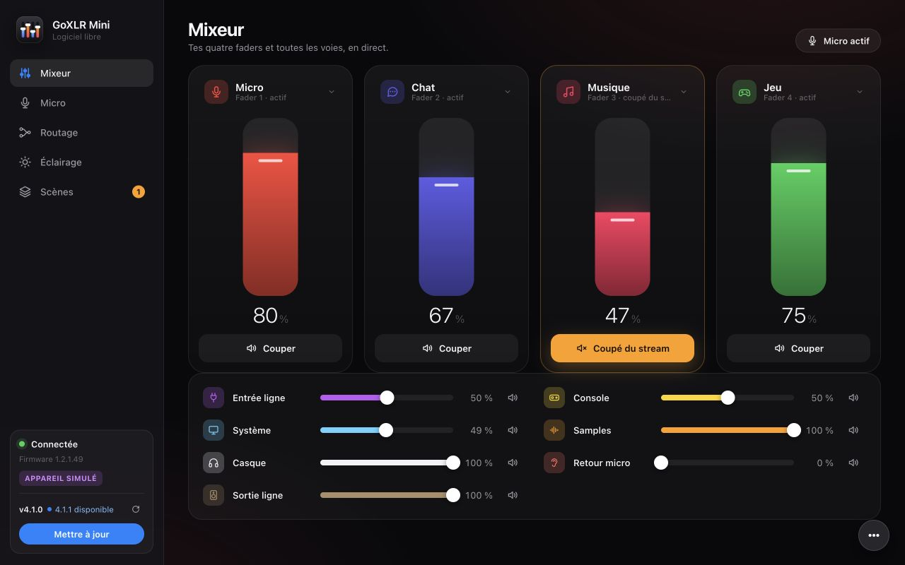
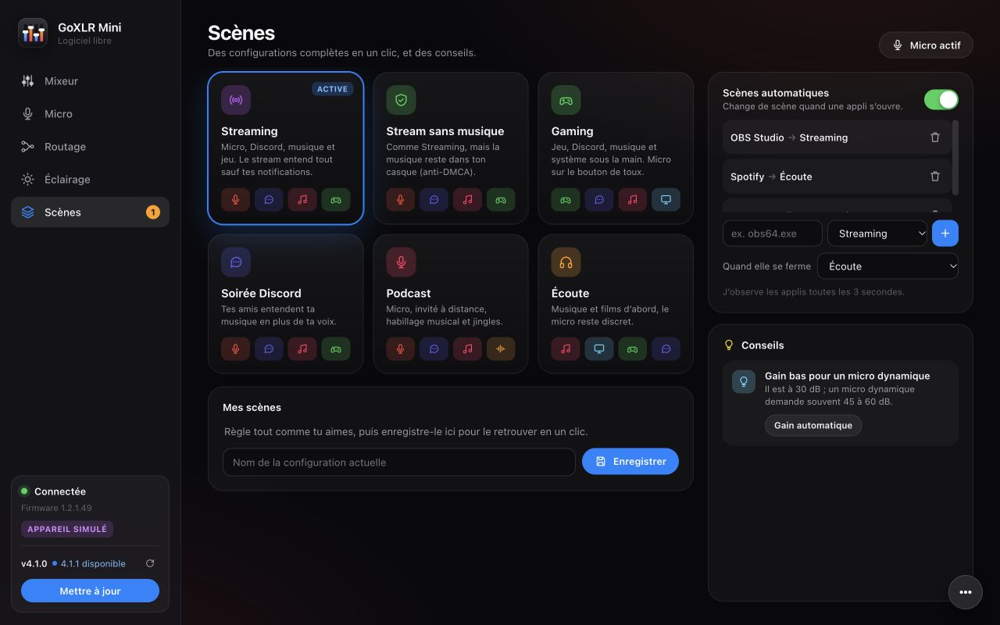
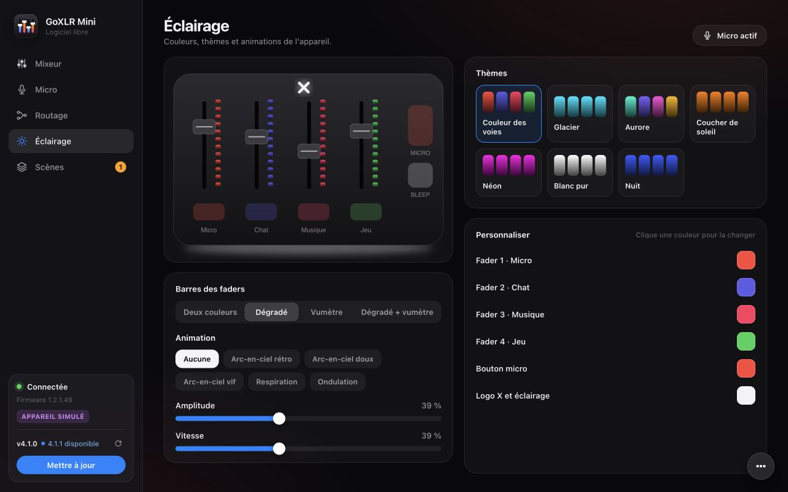
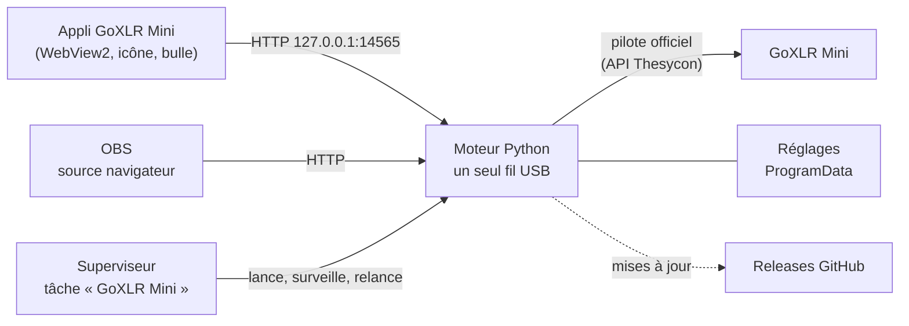

<p align="center">
  
</p>

<h1 align="center">GoXLR Mini</h1>

<p align="center">
  <b>Pilote ta GoXLR Mini sous Windows, sans GoXLR Utility, avec le seul pilote officiel.</b><br>
  Mixeur, micro, routage, éclairage, scènes automatiques, incrustation OBS… et des mises à jour en un clic.
</p>

<p align="center">
  <a href="https://github.com/samirmedani/goxlr-mini/releases/latest"></a>
  <a href="https://github.com/samirmedani/goxlr-mini/actions/workflows/ci.yml"></a>
  <a href="LICENSE"></a>
  
</p>

<p align="center">
  
</p>

*Open-source controller for the TC-Helicon GoXLR Mini on Windows, using only the official driver: mixer, mic
processing, routing, lighting, automatic scenes, OBS overlay and one-click updates. French interface.*

## Pourquoi

La GoXLR se pilote depuis l'ordinateur : sans logiciel, ses boutons ne coupent rien et ses couleurs restent
figées. GoXLR Mini est un petit moteur qui parle directement au pilote officiel de TC-Helicon, et une appli
claire pour tout régler. Il tourne en arrière-plan dès le démarrage de Windows, se relance seul s'il a un souci,
et reprend la GoXLR dès qu'elle est rebranchée.

## Ce qu'il sait faire

<table>
<tr>
<td width="50%"></td>
<td width="50%"></td>
</tr>
<tr>
<td><b>Micro</b> : détection du micro, gain automatique, six préréglages de voix, égaliseur, noise gate, compresseur, de-esser. Bouton micro en bascule, <i>maintenir pour couper</i> ou <i>appuyer pour parler</i>.</td>
<td><b>Routage</b> : qui entend quoi (toi, ton stream, Discord, la VOD, les enceintes). <b>VOD sans musique</b> : la VOD reçoit le stream sans la musique, anti-DMCA.</td>
</tr>
<tr>
<td></td>
<td></td>
</tr>
<tr>
<td><b>Scènes</b> : Streaming, Gaming, Soirée Discord, Podcast… en un clic, et <b>scènes automatiques</b> : « OBS s'ouvre → Streaming », « Spotify → Écoute ».</td>
<td><b>Éclairage</b> : thèmes (les barres prennent la couleur de la voie), couleurs par bouton, styles des barres, animations.</td>
</tr>
</table>

- **Couper d'une seule sortie** : chaque bouton mute a son mode (partout, stream, Discord, casque, enceintes).
  Appui long = coupé partout, le bouton clignote. Orange dans l'appli = coupé d'une sortie, rouge = partout.
- **Faders physiques** suivis en direct ; un trait pointillé montre l'écart avec le volume réglé dans l'appli.
- **Appli Windows** : icône d'état (rouge = micro coupé), bulle à l'écran quand le micro change (jamais de focus,
  même en jeu), menu rapide dans la zone de notification.
- **Incrustation OBS** : « Micro coupé » à l'écran du stream quand il ne t'entend plus
  (`http://127.0.0.1:14565/overlay`).
- **Diagnostic** en direct : état de la connexion, commandes, reconnexions, journal ; bouton « Reconnecter ».

<p align="center">
  
</p>

## Installer

1. Installe le **pilote officiel GoXLR** de TC-Helicon (il fournit les voies audio System, Game, Chat, Music…).
2. Ferme **GoXLR Utility** s'il est installé : deux logiciels ne peuvent pas piloter la GoXLR en même temps.
3. Télécharge **[GoXLR-Mini.zip](https://github.com/samirmedani/goxlr-mini/releases/latest/download/GoXLR-Mini.zip)**,
   décompresse-le, puis double-clique **`Installer.cmd`** (Windows demande les droits administrateur).

C'est tout : le moteur démarre avec Windows, l'appli se lance avec ta session et l'icône apparaît en bas à droite.
Tes réglages vivent dans `C:\ProgramData\GoXLR Mini` et survivent aux mises à jour. Pour désinstaller :
`Desinstaller.cmd`, ou *Paramètres › Applications*.

> L'exécutable n'est pas signé : Windows SmartScreen peut afficher « Windows a protégé votre ordinateur ».
> Choisis *Informations complémentaires › Exécuter quand même*, ou vérifie d'abord l'empreinte publiée avec la
> release (`GoXLR-Mini.sha256`).

## Mises à jour

<p align="center">
  
</p>

GoXLR Mini regarde s'il existe une nouvelle version 5 secondes après le démarrage, puis toutes les 6 heures. Une
version nouvelle est annoncée **une seule fois** ; la fenêtre montre ses notes. « Mettre à jour » :

1. télécharge `GoXLR-Mini.zip` **uniquement** depuis les releases de ce dépôt ;
2. compare sa taille et son empreinte **SHA-256** à celles annoncées par GitHub, et vérifie l'archive ;
3. garde la version en place de côté, installe la nouvelle et la redémarre ;
4. si la nouvelle version ne répond pas, **remet l'ancienne** toute seule.

Le seul échange avec Internet : `GET api.github.com/repos/samirmedani/goxlr-mini/releases/latest` (sans compte
ni identifiant), puis le téléchargement que tu as accepté. Aucune télémétrie.

## Comment ça marche



- Le moteur (`engine/goxlrctl.py`, Python 3.11, bibliothèque standard seulement) envoie les commandes USB de la
  GoXLR à travers le pilote officiel. Un seul fil parle à l'appareil ; l'interface ne l'attend jamais.
- Toute erreur USB ferme la connexion et en rouvre une propre qui réapplique tous tes réglages. Un superviseur
  relance le moteur s'il s'arrête ou se fige.
- L'interface (`engine/ui.html`) est une page web locale ; l'appli (`app/`, C# .NET 10) l'affiche dans une
  fenêtre WebView2 et gère l'icône, la bulle et le démarrage.

## Développer

Tout se code et se teste **sans GoXLR**, grâce à une fausse GoXLR qui imite le pilote, y compris ses pièges
(débranchement, pilote bloqué, compteur de commandes).

```bash
python3 -m unittest discover -s tests -v                              # tests du moteur et des mises à jour
python3 engine/goxlrctl.py daemon --child --simulate --port 14566     # puis http://127.0.0.1:14566/
```

Le diagnostic propose alors des boutons pour appuyer sur les touches, débrancher, rebrancher ou bloquer l'USB.
Une release se publie en poussant un tag `vX.Y.Z` : GitHub fabrique `GoXLR-Mini.zip` (Python embarqué officiel,
appli autonome) et la publie avec ses notes tirées de [CHANGELOG.md](CHANGELOG.md). Voir
[CONTRIBUTING.md](CONTRIBUTING.md).

## Compatibilité

- **GoXLR Mini** (firmware 1.2.x testé ; 1.3 pris en charge avec Stream Mix 2). La GoXLR « Full » n'est pas gérée.
- Windows 10 ou 11, 64 bits, pilote officiel GoXLR installé.
- Captures faites avec l'appareil simulé.

## Remerciements et licence

Les identifiants et formats des commandes USB s'appuient sur le travail du projet
[goxlr-utility](https://github.com/GoXLR-on-Linux/goxlr-utility) (MIT). Composants tiers :
[THIRD-PARTY-NOTICES.md](THIRD-PARTY-NOTICES.md).

GoXLR Mini est distribué sous licence [MIT](LICENSE). Projet indépendant, ni affilié ni soutenu par TC-Helicon ou
Music Tribe ; GoXLR est une marque de Music Tribe.
